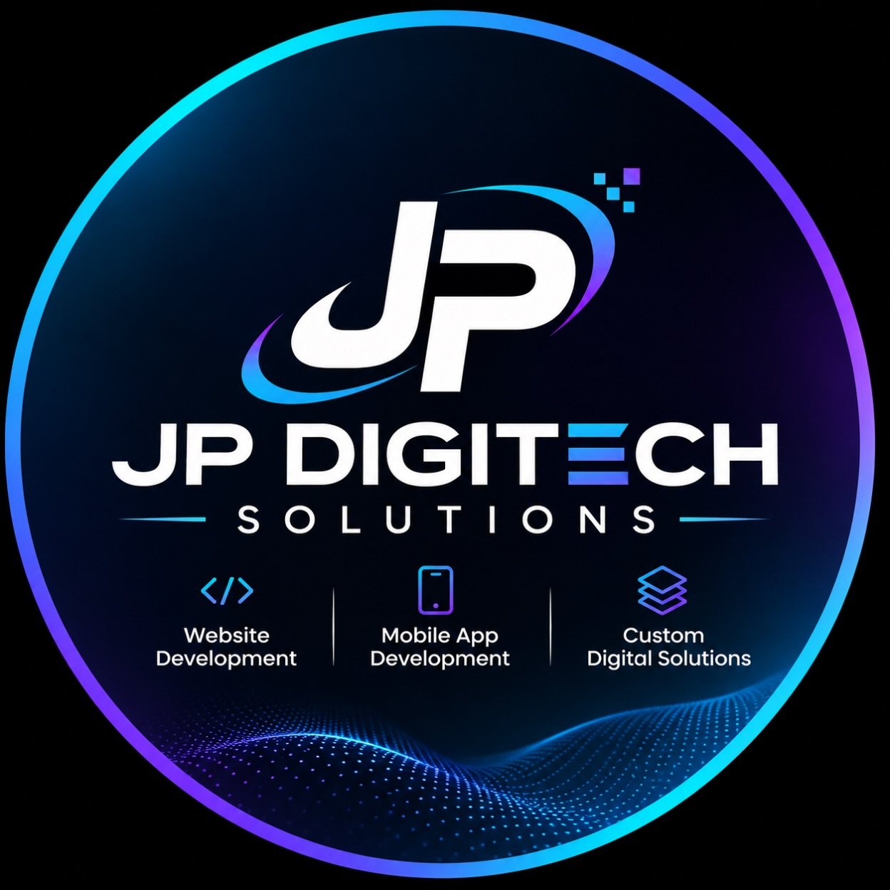

# 🚀 JP DigiTech Solutions - Official Website

Modern, responsive, cyber-themed digital agency website for **JP DigiTech Solutions** — specializing in high-speed website development, native cross-platform mobile apps, and custom enterprise software.



## 💎 Features & Architecture

- **Branding & Visuals**: Deep obsidian cyber aesthetic with electric cyan, blue, and neon violet glows derived directly from the official JP DigiTech logo.
- **Interactive 3D Cyber Wave**: HTML5 Canvas particle wave simulation mirroring the digital particle mesh in the brand logo, with mouse and touch responsiveness.
- **Dynamic Typewriter Headline**: Cycling through core services and value propositions.
- **Animated Metrics Counter**: Live stats ticking up when scrolled into view.
- **Core 3 Pillars Matching Brand Logo**: Highlighting Website Development, Mobile App Development, and Custom Digital Solutions.
- **Filterable Case Studies & Portfolio**: Filter by All, Web Platforms, Mobile Apps, and Enterprise SaaS with in-depth modal breakdowns.
- **Interactive Tech Stack Matrix**: Categorized grid of technologies (React, Next.js, Flutter, Swift, Node.js, Python, PostgreSQL, AWS, Docker).
- **Agile 4-Step Process Timeline**: Clear delivery roadmap from Discovery to Zero-Downtime Deployment.
- **Testimonial Slider**: Client feedback slider with star ratings and auto-rotation.
- **Interactive FAQ Accordion**: Expandable answers to common business and technical inquiries.
- **High-Converting Contact Section**:
  - Live client-side validation
  - WhatsApp Direct Chat button with pre-filled messages
  - 1-click clipboard copy for email and phone numbers
- **Zero-Dependency 100% Free Hosting Ready**: Runs directly on Netlify, GitHub Pages, Vercel, or Cloudflare Pages without any build steps or monthly hosting costs.

## 📂 Project Structure

```
JP/
├── index.html                  # Main responsive web platform
├── FREE_HOSTING_GUIDE.md       # Step-by-step free hosting instructions
├── README.md                   # Project documentation
├── logo.jpg                    # High-res official brand logo
└── assets/
    ├── css/
    │   └── styles.css          # Design system, glassmorphism, animations & responsiveness
    ├── js/
    │   ├── particles-wave.js   # 3D interactive wave canvas (matches logo)
    │   └── main.js             # Navigation, modals, slider, FAQ, form handlers
    └── images/
        ├── logo.jpg            # Optimized web asset logo
        └── favicon.png         # High-resolution web favicon
```

## 🌐 Free Hosting

See [FREE_HOSTING_GUIDE.md](file:///d:/Projects/JP/FREE_HOSTING_GUIDE.md) for 30-second drag-and-drop hosting on Netlify, GitHub Pages, or Vercel.

